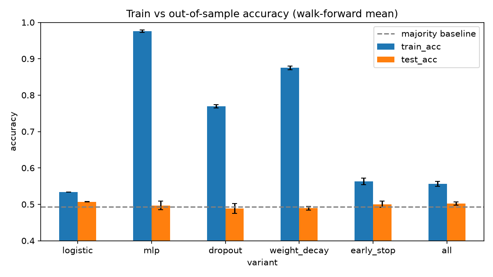

# Overfitting Demo: walk-forward validation on Nobitex BTCUSDT


A small PyTorch experiment that shows how easily a model memorises noisy price data, and how little regularisation helps when there is no signal to find. Six models are trained on daily BTCUSDT candles from Nobitex and compared with **walk-forward validation**, so every test window lies strictly after its training window. Results are averaged across five model-initialization seeds.

This is an evaluation exercise, not a trading strategy and not investment advice.

## Result



| Variant | Train acc (mean ± SD) | Test acc (mean ± SD) | Gap (pts, mean ± SD) | Test loss (mean ± SD) |
|---|---|---|---|---|
| logistic | 53.4% ± 0.0 | 50.7% ± 0.0 | 2.7 ± 0.1 | 0.687 ± 0.000 |
| mlp | 97.6% ± 0.3 | 49.7% ± 1.2 | 47.9 ± 1.2 | 2.434 ± 0.178 |
| dropout | 76.9% ± 0.5 | 48.9% ± 1.3 | 28.1 ± 1.7 | 0.911 ± 0.020 |
| weight_decay | 87.5% ± 0.5 | 48.9% ± 0.5 | 38.6 ± 0.7 | 0.987 ± 0.031 |
| early_stop | 56.3% ± 0.9 | 50.0% ± 0.8 | 6.3 ± 1.2 | 0.707 ± 0.007 |
| all | 55.6% ± 0.7 | 50.2% ± 0.5 | 5.4 ± 1.0 | 0.700 ± 0.003 |

Majority-class baseline: 49.4% test accuracy. Each seed has 29 walk-forward folds (1,740 test days); the table reports the mean and sample standard deviation of each seed's fold-averaged metric.

- The high-capacity MLP memorises its training window (97.6%) but does not beat the majority baseline out of sample (49.7%).
- Dropout, weight decay and early stopping shrink the train/test gap, but none shows a dependable lift over the baseline. A simple binomial standard-error estimate for 1,740 test days is about 1.2 percentage points; this is only a rough reference and does not account for time-series dependence.
- Takeaway: in-sample accuracy says nothing about out-of-sample skill. Without a forward-in-time test, the MLP would look like a 98% predictor.

## Method

- **Data:** Nobitex public UDF endpoint, BTCUSDT daily candles from 2021-01-01, cached in `data/`.
- **Features** (known at the close of day t): 1, 5 and 10-day log returns and 10-day realised volatility.
- **Label:** direction of the next day's close.
- **Walk-forward:** a rolling 365-day train window, the next 60 days as test, moved forward 60 days at a time (29 folds per seed). The last 20% of each train window is a chronological validation split used only by early stopping.
- **Seeds:** 42 through 46 by default. Metrics are first averaged over folds within each seed, then the five seed averages are summarized; the reported SD is not a confidence interval.
- **Leakage controls:** features use past data only, scaling statistics come from the training rows only, z-scores are clipped to ±5, and the still-open candle is dropped.
- **Models:** full-batch training with AdamW on CPU, at most about 5,000 parameters.

| Variant | Setup |
|---|---|
| logistic | linear model, baseline with no capacity to memorise |
| mlp | two hidden layers of 64 units |
| dropout | mlp with dropout 0.3 |
| weight_decay | mlp with weight decay 1.0 |
| early_stop | mlp, stops after 15 epochs without validation improvement |
| all | dropout, weight decay and early stopping together |

## Data notes

- Volume is zero in the Nobitex candles before 2025-06-30, so no volume features are used.
- A 14-day hole sits at that boundary. It is left as is and touches well under 1% of the rows.

## Quick start

Python 3.12 or newer.

```bash
python -m venv .venv && source .venv/bin/activate
pip install numpy pandas requests matplotlib pytest
pip install torch --index-url https://download.pytorch.org/whl/cpu   # CPU-only build, no GPU needed
python -m pytest
python -m overfit              # downloads and caches the candles on first run
python -m overfit --refresh    # re-download the candles
python -m overfit --seeds 1 2 3 4 5
```

Results are written to `reports/` (`folds.csv` includes one row per seed/fold/model; `summary.csv` includes means and cross-seed SDs; `summary.png` shows the SD as error bars). Options: `--symbol`, `--resolution D|60` and `--seeds`.

## Docker

The container uses a CPU-only PyTorch build. Data and reports are mounted so they persist outside the container:

```bash
docker build -t overfitting-demo .
mkdir -p data reports
docker run --rm \
  --user "$(id -u):$(id -g)" \
  -v "$(pwd)/data:/app/data" \
  -v "$(pwd)/reports:/app/reports" \
  overfitting-demo
```

## Layout

```
overfit/     package: config, data, model, validate, report, CLI
tests/       pytest suite (no network needed)
notebooks/   original synthetic-data demo
scripts/     original synthetic-data training scripts
```

`scripts/` and `notebooks/` are retained as the original synthetic-data prototype; their dependencies (`scikit-learn` and `jupyter`) remain in `requirements.txt`.

## Limitations

One asset and a single historical data source, next-day direction only, no transaction costs. Five initialization seeds do not represent independent market histories. Results depend on the data snapshot.

## License

MIT
